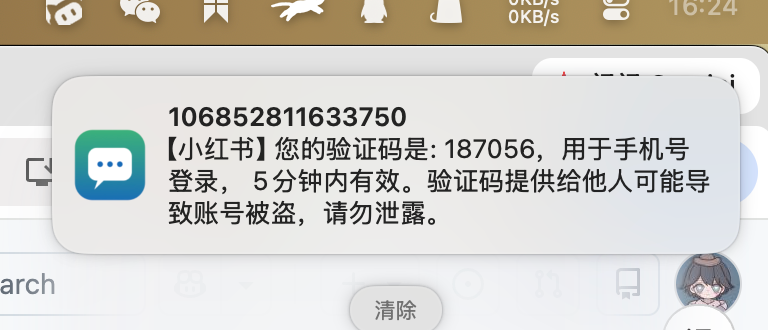

# harmony-mac-sync

把鸿蒙手机的短信同步到 Mac：新短信即时弹系统通知，并落库留档。

## 原理

Mac 作为蓝牙客户端，直连手机暴露的标准蓝牙服务，手机端零安装、不依赖任何鸿蒙权限：

| 通道 | 协议 | 用途 | 版本 |
|---|---|---|---|
| 短信 | MAP | 读取短信、订阅新消息事件 | V1 |
| 通讯录 | PBAP | 拉取通讯录与通话记录，反查来电姓名 | 规划中 |
| 来电 | HFP | 读取来电号码（CLIP） | 规划中 |

## 当前状态

V1 可用，形态是一个菜单栏应用：面板里选手机、开关监听、看最近收到的短信，另有独立的「消息记录」窗口翻全部历史。



*手机上收到的小红书验证码短信，几秒后在 Mac 上弹成系统通知——图标来自 App，标题是发件号码，正文是短信内容。*

- 新短信延迟 2–4 秒（`--interval 2`）
- 通知以 App 身份弹出（`HarmonySync.app`）：带 App 图标，能在通知中心里翻到
- 已见 handle 持久化，重启不重复通知
- 手机端 SDP 记录、OBEX 全链路、列表解析、事件订阅的实测记录见技术方案 §7

## 界面

菜单栏面板（宽 300）分三段，底部一条主操作：

| 分区 | 内容 |
|---|---|
| 连接 | 链路标记、手机名、状态指示 |
| 监听 | 短信监听、通话监听、开机自启三个开关，外加「更换手机…」 |
| 最近收到 | 最新两条短信，报发件人、正文、时刻 |

底部「打开消息记录」开出 560px 的窗口：关键字搜索 + 全部 / 今天 / 近 7 天三档时间筛选，按天分组吸顶，正文里认出验证码就在下面挂一个等宽数字的复制胶囊。窗口只读，不提供删除。

视觉系统见 `DESIGN.md`，实物样本见 `design/设计规范.html`。

## 目录

| 路径 | 说明 |
|---|---|
| `鸿蒙7-Mac消息同步-技术方案.md` | 完整技术方案与验证记录 |
| `PRODUCT.md` | 产品真值：平台、技术栈、能力与边界 |
| `DESIGN.md` | 视觉系统：颜色、字阶、圆角、间距、组件令牌 |
| `design/设计规范.html` | 设计规范的实物样本，深浅两套取值可切换 |
| `HarmonyCore.swift` | 引擎：增量同步 + 系统通知 + 落库 + 查询 |
| `HarmonyApp.swift` | App 入口：菜单栏项、窗口、后台形态 |
| `PanelView.swift` | 菜单栏面板与选手机页 |
| `MessageWindowView.swift` | 消息记录窗口 |
| `AppModel.swift` | 界面状态与引擎之间的那一层 |
| `DesignSystem.swift` | 视觉令牌与小组件（链路标记、开关、按钮、行底） |
| `HarmonyCLI.swift` | 命令行入口：跑同步、看日志、各种本地自检 |
| `hfp_probe.swift` | 通话探针：验证在 Mac 上接电话、通话音频走电脑 |
| `make_icon.swift` | 图标生成：App 图标 + 菜单栏模板图（链路通 / 断各一套） |
| `build.sh` | 编译 App 与命令行两个目标，组装成 `HarmonySync.app` |
| `package.sh` | 出可分发的 `dist/HarmonySync.app` 与 `dist/HarmonySync-1.0.dmg` |
| `run_sync.command` | 双击启动：增量同步 |
| `run_fast_sync.command` | 双击启动：秒级轮询 |
| `run_notify_check.command` | 双击运行：通知自检 |
| `run_hfp_probe.command` | 双击运行：通话探针 |
| `assets/notification.png` | 上面那张通知截图 |

验证阶段的探针（SDP 查询与发布、OBEX 报文、列表解析、手机能力）源码在 git 历史里，取证结果收在技术方案 §7.1–§7.4，取回方式见技术方案 §7.7。

## 安装

```bash
./package.sh
```

出 `dist/HarmonySync-1.0.dmg`：打开后把 `HarmonySync` 拖进 Applications（dmg 里放了快捷方式），双击就能用。应用自带图标、菜单栏模板图与 Info.plist，装在哪都能跑；数据落在 `~/Library/Application Support/HarmonySync/`。首次运行系统会问蓝牙与通知两项权限。

## 构建

```bash
./build.sh
```

出两个目标：`HarmonySync.bin` 组装成 `HarmonySync.app`（带蓝牙用途说明、图标与 ad-hoc 签名），`HarmonyCLI.bin` 留在仓库根目录供自检；末尾向 LaunchServices 登记。

## 运行

双击 `HarmonySync.app`，菜单栏出现链路标记，点开就是面板。这个形态常驻菜单栏、不占 Dock。首次要在面板里选一次手机，之后开关是开着的状态就自动连上。

命令行入口与 App 共用同一份引擎，自检都在这里跑：

```bash
./HarmonyCLI.bin                          # 持续同步
./HarmonyCLI.bin --interval 2             # 秒级轮询
./HarmonyCLI.bin --test-notify            # 通知自检
./HarmonyCLI.bin --parse listing.xml      # 解析一份列表，看条数与正文
./HarmonyCLI.bin --codes codes.txt        # 验验证码识别，一行一条正文
./HarmonyCLI.bin --dump-notif             # 打印五种订阅写法的报文
./HarmonyCLI.bin --mns-selftest           # 事件订阅自检
```

日志落在 `/tmp/harmony_sync_result.txt`，同时打到标准输出。菜单栏进程的退出在「活动监视器」里结束 `HarmonySync`。

首次运行需要在系统询问里允许蓝牙与通知。若错过那次询问，到「系统设置 → 通知」里把本 App（`HarmonySync`）的开关打开即可。

本地数据：`~/Library/Application Support/HarmonySync/messages.db`（`message` / `seen_handle` / `sync_state` 三张表）

## 能力边界

**可同步**：短信

**不可同步**：App 推送通知

后者源于平台限制：鸿蒙把通知监听划为系统签名级权限、把短信读取划为 ACL 受限权限，第三方应用无法获取；官方的跨设备通知同步运行在华为分布式软总线内，Mac 不在该生态中。

## 环境

- 手机：HarmonyOS 7（实测 华为 Pura 80 Pro）
- Mac：macOS 13+
- 工具链：Swift / SwiftUI / IOBluetooth / SQLite3

## 授权说明

macOS 的蓝牙权限按「负责进程」归因。从终端或 IDE 的 shell 启动的进程可能因宿主未声明蓝牙用途而被系统拒绝，此时请从 Terminal.app 直接运行，或双击 app bundle。
